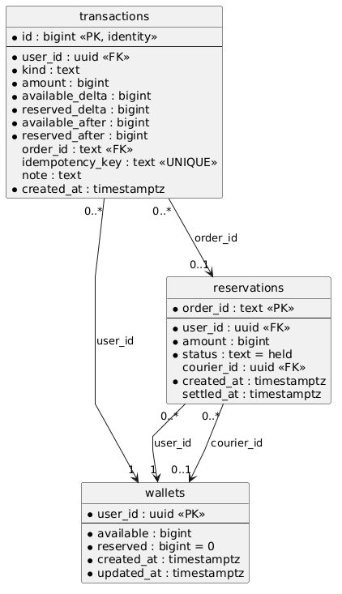

# D3: Credit Service design and implemented flows

This document answers the D3 credit questions against the current repository
implementation. Examples below illustrate the implemented contracts; they are
not transcripts of a live deployment. Source links identify the evidence for
each flow. The full endpoint contract is in [API.md](API.md).

The numbered sections follow the four D3 checklist categories. Bold prompts
identify the checklist item answered by the text immediately below; compound
items are split into separate prompts.

## 1. Database choice and credit data model

### Database choice

**Which database technology (SQL/NoSQL) have you selected?**

**Implemented:** PostgreSQL, a SQL relational database. The development and test
Compose services use `postgres:18-bookworm` (see [compose.yaml](compose.yaml)).

**Justify your choice based on FoC's credit-related queries, concurrent updates,
and consistency requirements.**

FoC needs point reads of a user's wallet, paginated credit history, a reservation
lookup by order ID, and transfers affecting two users. These are structured,
related records with natural primary and foreign keys. SQL fits these queries:
wallet and reservation primary keys support direct lookups, while
`transactions(user_id, id DESC)` supports newest-first history and cursor paging.

More importantly, a payout must debit a requester and credit a courier together;
concurrent orders must not spend the same available credits. PostgreSQL supplies
ACID transactions, `SELECT ... FOR UPDATE` row locks, uniqueness constraints and
nonnegative balance checks. The implementation uses these to serialize competing
writes and commit balances, reservation state and history together. A NoSQL
database could support an equivalent design with suitable transaction support,
but SQL directly meets these consistency and query requirements without needing
an additional coordination mechanism inside Credit Service.

### Concrete schema

**Present a concrete schema/data model showing users' credit balances,
reservations associated with orders, and records of credit operations.**

The complete executable schema, including constraints and triggers, is
[migration 001](internal/credit/migrations/001_initial.sql). Credits are positive
whole-number amounts represented by PostgreSQL `bigint` and Go `int64`.

| Table | Columns and relationships |
| --- | --- |
| `wallets` | `user_id uuid PRIMARY KEY`; `available bigint NOT NULL CHECK (available >= 0)`; `reserved bigint NOT NULL DEFAULT 0 CHECK (reserved >= 0)`; `created_at`, `updated_at timestamptz` |
| `reservations` | `order_id text PRIMARY KEY`; `user_id uuid NOT NULL REFERENCES wallets(user_id)`; `amount bigint NOT NULL CHECK (amount > 0)`; `status text` in `held`, `released`, `transferred` (default `held`); nullable `courier_id uuid REFERENCES wallets(user_id)`; `created_at`, nullable `settled_at timestamptz` |
| `transactions` | `id bigint GENERATED ALWAYS AS IDENTITY PRIMARY KEY`; `user_id uuid NOT NULL REFERENCES wallets(user_id)`; `kind text`; positive `amount bigint`; `available_delta`, `reserved_delta bigint`; nonnegative `available_after`, `reserved_after bigint`; nullable `order_id text REFERENCES reservations(order_id)`; nullable unique `idempotency_key text`; nullable `note text`; `created_at timestamptz` |

### Schema diagram (PlantUML)

The diagram shows the implemented Credit database relationships. `*` denotes a
required column (rendered as a filled circle); unmarked columns are nullable.
Arrows point from the foreign-key table to the referenced table's primary key.
Endpoint cardinalities use `1` (exactly one), `0..1` (optional one) and `0..*`
(zero or more). For example, each reservation references one requester wallet,
and a wallet can be referenced by many reservations.



The editable [PlantUML source](assets/credit-schema.puml) and scalable
[SVG image](assets/credit-schema.svg) are also available in `assets/`.

### User-ID indexes

| Table | Implemented index on user ID |
| --- | --- |
| `wallets` | Yes. PostgreSQL automatically creates a unique index for the `user_id` primary key. |
| `transactions` | Yes. Explicit composite index `transactions_user_history (user_id, id DESC)` supports user history queries. |
| `reservations` | No index on `user_id` or `courier_id`. Its primary-key index is on `order_id`, which current reservation operations use for lookup. |

Foreign keys do not automatically create indexes on the referencing columns in
PostgreSQL. An index for listing reservations by requester or courier has **not
been implemented**; it would be appropriate to evaluate if those queries are
introduced.

User IDs identify accounts owned by User Service; Credit stores no passwords or
sessions and has no foreign key into User's database. Order IDs similarly refer
to Order Service records without shared database access. A reservation must have
a courier exactly when it is `transferred`, and that courier cannot be its
requester. Released/transferred reservations remain stored as retry records.

### Stored reserved and total values

**Explain how reserved and total values are stored.**

The wallet stores `available` and `reserved`. It does **not**
store a separate `total` column or return `total` in its wallet API:

```text
total owned credits = available + reserved
available = spendable on another order
reserved = sum of this user's held reservation amounts
```

Reserving or releasing changes the split but preserves the requester's total.
Payout decreases that total and increases the courier's by the same amount.
An initial allocation creates credits; an admin debit removes available credits.

### Maintaining consistency

**Explain how the consistency of reserved and total values is maintained.**

Every operation runs through `inTx`, and every balance change uses
`ledgerTx.apply` in [ledger.go](internal/credit/ledger.go). Reservation changes,
wallet updates and ledger inserts share the same transaction. A failure rolls
back all of them, including both wallets in a payout.

| Ledger kind, for amount `x` | Available delta | Reserved delta |
| --- | --- | --- |
| `allocation` | `+x` | `0` |
| `reserve` | `-x` | `+x` |
| `release` | `+x` | `-x` |
| `spend` (requester payout) | `0` | `-x` |
| `receive` (courier payout) | `+x` | `0` |
| `admin_debit` | `-x` | `0` |

Wallet locks serialize concurrent writes. Release/payout first lock the
reservation; payout then locks both wallets in ascending user-ID order. Reserve
locks the requester wallet before checking/inserting its reservation. The
reservation primary key prevents two different users from reserving the same
order ID.

Database checks reject negative balances and ledger deltas inconsistent with
their kind. Triggers reject updates, deletes and truncation of history. Thus
history preserves each operation and its post-operation balances. The service
write path maintains the cross-table balance/reservation invariants; there is
**no database trigger that recomputes wallet totals from reservations or history**.
The Credit tests check wallet balances against ledger sums after each test.
Post-commit logs aid diagnosis, but the database ledger is the durable record;
logging after commit is not a durable message outbox.

## 2. Initial credit allocation

### Amount and configuration

**State the initial credit allocation selected by your team and explain how it
is configured.**

**Implemented:** each newly verified user receives **100 credits**, configured
as `CREDIT_INITIAL_CREDITS: "100"` in [compose.yaml](compose.yaml).
[LoadConfig](internal/credit/config.go) rejects a missing, non-integer or
nonpositive value at startup. Changing it affects newly created wallets; it
does not top up existing wallets.

**Ensure that the credit allocation is reasonable and not too paltry.**

For scale, 100 credits funds five errands offering 20 credits each, or three
offering 30 credits with 10 remaining. These are illustrative offers, not a
mandated tariff. The allocation therefore permits several requests before the
user needs to earn credits by couriering. **A measured economy/pricing study is
not implemented**, so long-term adequacy would need evaluation using actual
offer sizes and usage.

### Integration with User Service

**Explain how the initial allocation is granted during registration and the
integration with the User Service.**

The grant occurs **after successful email verification**, not on the initial
registration request:

1. `POST /api/v1/auth/register` creates an unverified account and sends a
   verification challenge. It returns `202` and a `registrationToken`; no credit
   wallet is granted yet.
2. `POST /api/v1/auth/verify-email` validates the email code and registration
   token. In one User database transaction it activates the account, consumes
   the challenge and inserts a `credit_allocations` job keyed by user ID.
3. After that commit, User tries
   `POST /internal/v1/wallets/{userId}/initial-allocation` on Credit's internal
   HTTP listener using its configured bearer credential. No body is required.
4. Credit inserts a zero-balance wallet and applies the 100-credit allocation
   with its ledger entry in one Credit database transaction. It returns `200`:

   ```json
   {"userId":"11111111-1111-4111-8111-111111111111","available":100,"reserved":0}
   ```

5. User marks its durable job `completed_at` only after confirming `200`.
   Verification returns `200` once the account is verified, even if wallet
   setup remains pending. Login requires valid credentials and verification,
   and does not wait for Credit.

Evidence: [verification handler](../user-service/internal/user/auth.go),
[allocation client and worker](../user-service/internal/user/credits.go),
[durable allocation schema](../user-service/internal/user/migrations/004_credit_allocations.sql),
and [AllocateInitial](internal/credit/credit.go).

### Failed or delayed credit setup

**What happens when user registration succeeds but credit-account creation or
allocation fails or is delayed?**

If User's activation/job transaction fails, activation is rolled back. If the
later Credit HTTP call fails, is delayed, or loses its response, activation
remains committed and the durable job remains pending. The worker polls every
second, claims due jobs using `FOR UPDATE SKIP LOCKED` and a 15-second lease,
and schedules failed attempts with exponential backoff capped at 300 seconds.
Jobs and retry metadata survive User Service restarts.

`GET /api/v1/users/me` exposes `creditSetup: pending|ready|not_applicable`.
`pending` means User has not confirmed the grant; Credit may already have
committed it. `ready` confirms setup, not the current balance. Before wallet
creation, a wallet read returns `404 wallet_not_found`, and Order maps this to
`409 wallet_not_ready` when reserving. The user can still log in.

### Preventing duplicate allocation

**How do you prevent the same user from receiving the initial allocation more
than once because of repeated requests?**

Credit uses `INSERT ... ON CONFLICT (user_id) DO NOTHING`. Only the transaction
that creates the wallet applies `allocation`; a repeated call locks and returns
the existing wallet without granting credits. A simultaneous insert waits for
the competing transaction. Wallet creation and allocation cannot commit
separately, so a failed grant leaves no partially created wallet.

This provides an exactly-once **allocation effect** with retryable HTTP calls.
A crash after Credit commits but before User records completion is safe: the
worker repeats the same user ID and receives the existing wallet. Retrying after
spending credits returns the current balance; it does not restore it to 100.

### Demonstrating the flow

**Demonstrate the implemented registration-to-allocation flow.**

The following is a reproducible walkthrough using the existing public APIs;
keep credentials, verification codes and tokens out of committed files:

| Step | Request/action | Expected observation |
| --- | --- | --- |
| Register | `POST /api/v1/auth/register` with `email`, `displayName`, `password` | `202`; retain returned registration token; no allocation yet |
| Verify | Read the code in local Mailpit (`http://localhost:8025`); `POST /api/v1/auth/verify-email` with `email`, `code`, `registrationToken` | `200`; account verified, allocation attempted |
| Log in | `POST /api/v1/auth/login` with `email`, `password` | `200`; browser receives session cookie |
| Inspect setup | `GET /api/v1/users/me` with that cookie | `creditSetup` is `ready`, or `pending` during an outage |
| Inspect wallet | `GET /api/v1/wallets/me` with that cookie | Once ready: available `100`, reserved `0` |
| Inspect history | `GET /api/v1/wallets/me/transactions` | One `allocation` entry of `100` for a fresh wallet |
| Retry allocation internally | Repeat the same user-ID allocation request from an authorized backend | Same current wallet, no second allocation entry |

Run through the gateway at `http://localhost:3000`; User and Credit's direct
development ports are `8080` and `8082`. Public writes require the trusted
`Origin: http://localhost:3000`. The internal allocation endpoint is available
only on the Compose network.

Existing automated evidence includes `TestCreditAllocationRecovery` and
`TestCreditAllocationLostResponse` in
[User integration tests](../user-service/internal/user/integration_test.go), and
`TestAllocateInitial` / `TestAllocateEndpoint` in the
[Credit domain](internal/credit/credit_test.go) and
[HTTP tests](internal/credit/http_test.go). User's tests simulate Credit outcomes;
they are not themselves a live two-service HTTP demonstration.

**Not implemented:** automatic backfill of accounts verified before this
integration. Such accounts have no allocation job and report `not_applicable`.

## 3. Reservation, transfer and release

### Atomic balance and reservation updates

**Ensure that balance and reservation updates within the Credit Service are
atomic.**

As explained in section 1's “Maintaining consistency,” each operation commits
its reservation changes, wallet updates and ledger entries in one Credit
database transaction. A payout includes both requester and courier wallets in
that transaction; a failure rolls back all changes.

### Reserving an order's credits

**Explain how credits are reserved when an order is placed, including the correct
sequence of operations.**

**Implemented:** Order durably records its creation attempt and exact financial
payload before contacting Credit. It confirms reservation before committing the
actual order. This is more precise than “reserve before saving anything”: the
recovery intent must be saved first.

1. Order authenticates the requester, validates the request and resolves places.
   It serializes the creation attempt using a PostgreSQL advisory lock and
   commits a `reserving` intent with requester, offer and stable order ID.
2. Order calls `PUT /internal/v1/escrows/{orderId}` with
   `{"userId":"<requester UUID>","amount":30}`.
3. Credit starts a transaction, locks the requester wallet, and checks whether
   that order ID already has a reservation. The same requester/amount is a
   successful no-op; different values return `409 idempotency_conflict`.
4. For a new reservation, Credit inserts the `held` reservation and applies
   `available -= 30`, `reserved += 30`, recording a `reserve` ledger entry.
   Sufficient funds are checked by the resulting wallet's nonnegative database
   constraint under the wallet lock. Insufficient available credits cause
   rollback and `409 insufficient_credits`; no reservation survives.
5. After Credit confirms success, Order commits the order, completed-attempt
   marker and creation event together. Failure invokes cleanup (section 4).

**How is sufficient available balance checked?**

A prior balance read may help the UI, but it cannot authorize spending; the
locked transactional update in step 4 is authoritative. The nonnegative balance
constraint rejects an amount exceeding the available balance and rolls back
the operation.

**How are reserved credits prevented from being used for another order?**

Another order can spend only
`available`, never the credits already in `reserved`. An admin debit likewise
does not touch reserved funds. See
[Credit operations](internal/credit/credit.go) and
[Order creation](../order-service/internal/order/create.go).

### Transfer after completion

**Explain how reserved credits are transferred to the assigned courier after
successful completion.**

Order owns lifecycle decisions and the assigned courier. When completion is
committed, it durably queues a payout to that courier; its worker calls
`POST /internal/v1/escrows/{orderId}/payout` with
`{"courierId":"<assigned courier UUID>"}`. Credit locks the reservation and both
wallets, checks that it is held and that the courier is not the requester, then:

- Marks the reservation `transferred`, storing courier and settlement timestamp.
- Subtracts its amount from the requester's `reserved` balance (`spend`).
- Adds that amount to the courier's `available` balance (`receive`).
- Commits the reservation, both balances and both history entries together.

Successful payout returns `204`. Retrying with the same courier pays nothing
again. Another courier or an already released reservation causes
`409 escrow_settled`. The courier must already have a wallet; otherwise the
transaction fails without debiting the requester.

Credit does not query Order to verify completion or assignment; it trusts the
authorized backend caller. Order enforces these rules before creating its
payout job. Manual confirmation first returns `202` for completion intent;
Order also supports automatic completion and administrator dispute resolution.
Payout is queued only with the final `completed` transition. See
[Order changes](../order-service/internal/order/changes.go) and
[settlement](../order-service/internal/order/settlement.go).

### Release on cancellation or expiry

**Explain how reserved credits are released back to the requester's available
balance when an order is cancelled or expires.**

Order commits cancellation/expiry and an `order_refunds` job together. Its worker
calls `POST /internal/v1/escrows/{orderId}/release` (no body). Credit locks the
reservation, marks it `released`, and applies `available += amount`,
`reserved -= amount` with a `release` ledger entry in the same transaction.
It returns `200` with the wallet. Repeating a release is a no-op; releasing a
transferred reservation fails with `409 escrow_settled`. Release and payout
cannot both settle the same escrow because they lock the same reservation row.

**Not implemented:** a cancellation-after-pickup credit penalty. Credit releases
the full reservation. Order currently permits requester cancellation only while
`open` or `accepted`; expiry also covers `picked up`, and administrator
`not completed` resolution queues a full release.

### Balance examples

**Show the requester's and courier's balances before and after the relevant
operations.**

Assume requester R and courier C each started with 100 credits, with no other
orders. Each cell below shows **available / reserved / total**. The completion
and cancellation rows are alternative outcomes of the same 30-credit hold.

| Operation | R before | R after | C before | C after |
| --- | --- | --- | --- | --- |
| Reserve 30 | 100 / 0 / 100 | 70 / 30 / 100 | 100 / 0 / 100 | 100 / 0 / 100 |
| Complete and successfully pay C | 70 / 30 / 100 | 70 / 0 / 70 | 100 / 0 / 100 | 130 / 0 / 130 |
| Alternatively cancel/expire and successfully release | 70 / 30 / 100 | 100 / 0 / 100 | 100 / 0 / 100 | 100 / 0 / 100 |
| While release or payout is temporarily unavailable | 70 / 30 / 100 | 70 / 30 / 100 | 100 / 0 / 100 | 100 / 0 / 100 |

With the first 30 reserved, trying to reserve another 80 fails because available
is only 70. Neither wallet nor the new reservation changes. Successful payout
preserves the combined R+C total of 200; it merely changes ownership.

## 4. Integration and cross-service consistency

### Interfaces and permitted callers

**Define the Credit Service's interfaces and explain which services may invoke
each operation.**

| Operation | Interface | Intended caller and result |
| --- | --- | --- |
| Own balance | `GET /api/v1/wallets/me` | Signed-in user/frontend; `200` wallet |
| Own history | `GET /api/v1/wallets/me/transactions` | Signed-in user/frontend; `200` paginated history |
| Admin debit | `POST /api/v1/admin/wallets/{userId}/debits` with `amount`, `reason`, `requestId` | User with admin role; `200` wallet; available credits only |
| Internal balance | `GET /internal/v1/wallets/{userId}` | Order or authorized backend; `200` wallet |
| Internal history | `GET /internal/v1/wallets/{userId}/transactions` | Authorized backend; `200` history |
| Initial allocation | `POST /internal/v1/wallets/{userId}/initial-allocation` | User after verification; `200` wallet |
| Reserve | `PUT /internal/v1/escrows/{orderId}` with `userId`, `amount` | Order creation; `200` wallet |
| Release | `POST /internal/v1/escrows/{orderId}/release` | Order cleanup/cancellation/expiry/resolution; `200` wallet |
| Payout | `POST /internal/v1/escrows/{orderId}/payout` with `courierId` | Order completed settlement; `204` |

Public requests validate User's session through its internal endpoint on every
request, without caching authentication. Public writes also check the trusted
Origin. Internal operations require `Authorization: Bearer <CREDIT_INTERNAL_TOKEN>`
on port `8081`; that listener is not published by the public gateway. Error
responses use `{"error":{"code":"...","message":"..."}}`.

**Authorization limitation:** the internal API implements one shared bearer
token, not separate service identities or per-operation scopes. “User” and
“Order” above describe intended ownership; any backend possessing the token can
technically call any internal operation. Credit also does not independently
verify account activation on allocation. Supplier and the frontend have no
business role in invoking credit mutations through this internal API.

The admin debit endpoint is implemented, but [API.md](API.md) explicitly records
that it was not in the D1 backlog and requires team agreement/backlog inclusion
before use. There is no public arbitrary user-to-user transfer endpoint.

### Partial failures and recovery

**Explain what happens when an operation succeeds in one service, but a related
operation fails in another.**

There is **no distributed database transaction** between services. Each service
commits locally; durable intent records, idempotent HTTP operations and retries
provide eventual cross-service consistency.

**What happens if credits are reserved, but order creation fails?**

The reservation/order-persistence and uncertain-reservation rows below describe
cleanup and retry behavior.

**What happens if an order is completed while credit transfer is temporarily
unavailable?**

The completion/payout row below describes the pending payout and its retry.
The table also covers other partial failures in the implemented flows.

| Partial failure | Implemented response and recovery |
| --- | --- |
| User verification succeeds; allocation fails or reply is lost | The account stays verified and can log in. The pending `credit_allocations` job retries the same user ID until `200` is confirmed, without a duplicate grant. |
| Reservation succeeds; order persistence fails | Order checks for a saved order under the creation-attempt lock. If none exists, it records `release_pending` and releases the escrow. Failed cleanup stays durable for recovery; the abandoned attempt cannot later create an order. |
| Reservation result is uncertain, possibly still executing | Cleanup first tries release. If the escrow is missing, it repeats the exact reservation ID/request and then releases it. This creates or observes a persistent retry record so a late original reserve cannot hold funds again. Failures remain pending. |
| Order commits successfully but the client loses its response | Reusing the same creation idempotency key and body returns the saved order. Recovery never refunds a saved order. |
| Cancellation/expiry commits; release is unavailable | The order remains cancelled/expired, with its durable `order_refunds` job. Credits remain reserved until a release succeeds. |
| Completion commits; payout is unavailable | The order remains completed, with its durable `order_payouts` job and assigned courier. The worker retries; until payout succeeds the requester retains the hold and the courier has not received credits. |
| Release/payout commits but its reply, or the local job-deletion write, fails | The job remains and the next attempt repeats the same escrow operation. Credit's terminal reservation state prevents a second balance change. |

### Detecting and resolving incomplete operations

**Explain how incomplete cross-service operations are detected and resolved.**

User identifies incomplete allocations by `completed_at IS NULL`, due time and
expired leases. Order identifies stale `creation_attempts` in `pending`,
`reserving` or `release_pending`, and pending rows in `order_refunds` and
`order_payouts`. The Order recovery loop runs at startup and every 30 seconds by
default; creation attempts become stale after one minute, with at most 100
selected per pass. It skips active creations using advisory locks. Refund and
payout batches are also limited to 100, and attempted jobs rotate using
`last_attempt_at`. Successful remote confirmation removes the settlement job;
failed work remains for a later pass.

Sources: [Order recovery](../order-service/internal/order/recovery.go),
[refund worker](../order-service/internal/order/changes.go),
[payout worker](../order-service/internal/order/settlement.go), and
[worker configuration](../order-service/internal/order/config.go).
The existing [recovery tests](../order-service/internal/order/recovery_test.go)
cover lost reservation/release replies, late reservations, restart recovery,
and protection of saved orders.

Retries require dependencies to recover and the payload/state to be valid; they
do not promise bounded settlement during an outage. A legacy creation attempt
without its saved reservation payload and with no visible escrow is retained
for operator investigation rather than falsely declared refunded.

**Not implemented:** a broker-based credit event integration, a distributed
two-phase commit, or an automatic global reconciliation scan that compares all
Credit escrows with all Order records. Recovery uses the durable jobs above.
There is also no automatic Credit-side reservation expiry: Order determines
expiry and requests release. Reliable unattended Supplier-deactivation detection
is still incomplete, as recorded in [Order's README](../order-service/README.md);
this limits when that cancellation trigger can be detected, not the atomicity
of a release once requested.
